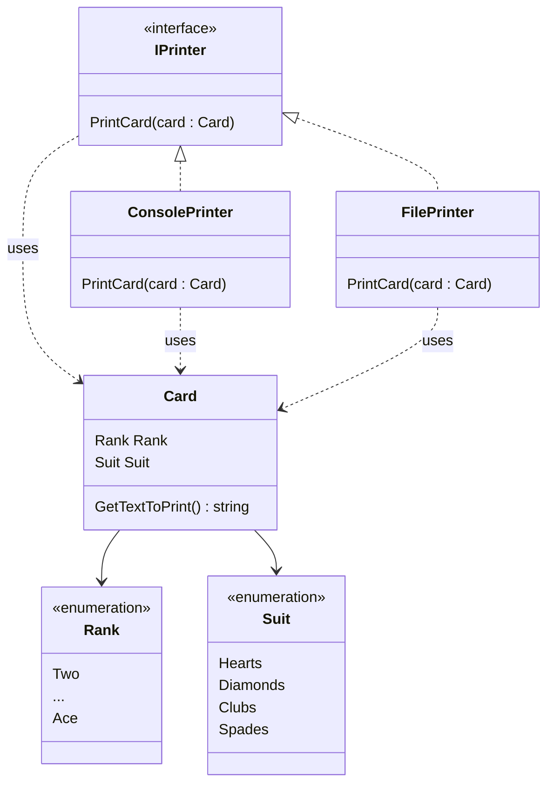

<!-- markdownlint-disable-next-line MD033 MD041 -->


# Universidad Católica del Uruguay

## Programación II

# Ejercicio de aplicación del Dependency Inversion Principle

## Objetivo

El objetivo de este ejercicio es aplicar el [Dependency Inversion
Principle](https://github.com/ucudal/PII_Guias/blob/main/DIP.md). El principio
dice:

> Las clases de alto nivel no deben depender de clases de bajo nivel; ambas
> deben depender de abstracciones.
>
> Las abstracciones no deben depender de detalles; los detalles deben depender
> de abstracciones.

## Contexto

En este ejercicio vamos a imprimir naipes de póker en la consola y en un
archivo. Cada naipe tiene un valor, de `Two` a `Ace`, y un palo: `Hearts`,
`Diamonds`, `Clubs` o `Spades`.



Te damos el código de las clases [`Card`](./src/Library/Card.cs),
[`ConsolePrinter`](./src/Library/ConsolePrinter.cs) y
[`FilePrinter`](./src/Library/FilePrinter.cs), de la interfaz
[`IPrinter`](./src/Library/IPrinter.cs) y de los enumerados
[`Rank`](./src/Library/Rank.cs) y [`Suit`](./src/Library/Suit.cs) funcionando,
así como un ejemplo de uso en la clase [`Program`](./src/Program/Program.cs). El
ejemplo crea el as de picas y lo imprime como `Ace of Spades` en la consola y en
el archivo `Card.txt`.

### Parte 1. Identificar la dependencia

Revisa las clases [`ConsolePrinter`](./src/Library/ConsolePrinter.cs) y
[`FilePrinter`](./src/Library/FilePrinter.cs). ¿Cuáles son las clases de alto
nivel y cuáles las de bajo nivel en este programa? ¿De qué clase concreta
dependen las impresoras?

> [!NOTE]
>
> ¿Qué pasaría si quisieras imprimir algo que no sea un naipe, o imprimir el
> naipe en otro formato? ¿Podrías reutilizar `ConsolePrinter` y `FilePrinter`
> sin modificarlas?

### Parte 2. Aplicar el principio de inversión de dependencias

Como te habrás dado cuenta, las clases
[`ConsolePrinter`](./src/Library/ConsolePrinter.cs) y
[`FilePrinter`](./src/Library/FilePrinter.cs), y la interfaz
[`IPrinter`](./src/Library/IPrinter.cs), dependen de la clase concreta
[`Card`](./src/Library/Card.cs): no dependen de una abstracción.

Agrega una abstracción, por ejemplo una interfaz `ICardContent` con el método
`string GetTextToPrint()`, y modifica `IPrinter`, `ConsolePrinter` y
`FilePrinter` para que dependan de esa abstracción en lugar de depender de
`Card`. Luego modifica `Card` para que implemente esa abstracción.

> [!NOTE]
>
> ¿Tuviste que cambiar la clase [`Program`](./src/Program/Program.cs)? No
> debería ser necesario.

### Parte 3. Agregar un nuevo formato

Agrega la posibilidad de imprimir los naipes con símbolos, por ejemplo `A♠` en
lugar de `Ace of Spades`, o `10♥` en lugar de `Ten of Hearts`, **sin modificar**
las clases `Card`, `ConsolePrinter` ni `FilePrinter`. Te damos el código para
obtener el símbolo de cada palo a continuación:

```csharp
string symbol;
switch (card.Suit)
{
    case Suit.Hearts:
        symbol = "♥";
        break;
    case Suit.Diamonds:
        symbol = "♦";
        break;
    case Suit.Clubs:
        symbol = "♣";
        break;
    default:
        symbol = "♠";
        break;
}
```

Usa el programa para imprimir el mismo naipe en ambos formatos, en la consola y
en el archivo.

> [!NOTE]
>
> ¿En cuántos lugares tuviste que hacer cambios? ¿Tuviste que modificar alguna
> de las impresoras?

## Uso de 

Es posible usar GitHub Copilot en este repositorio. Consulta [cómo usar Copilot
para aprender](./COPILOT.md).
